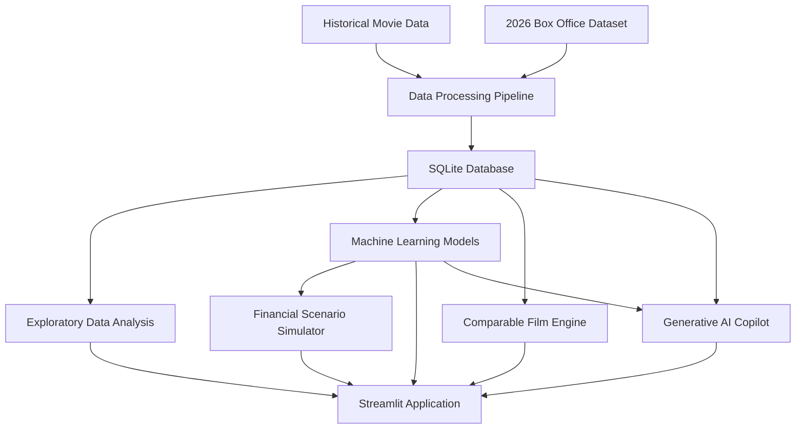

# CineScope AI

### AI-Powered Film Market Intelligence & Decision Support Platform

> Transforming historical box office data into predictive intelligence
> and actionable business insights.

## Overview

CineScope AI is an AI-powered film market intelligence platform designed
to help entertainment industry professionals evaluate the commercial
potential of theatrical film releases.

The project aims to integrate machine learning, predictive analytics,
financial scenario modeling, recommendation systems, and generative AI
within a unified decision-support application.

CineScope AI builds upon my existing 2026 Movie Box Office Report,
developed using Tableau Public, extending descriptive analytics into
predictive and prescriptive analytics.

## Business Problem

Film studios, production companies, and distribution partners make
significant financial commitments before knowing how a theatrical
release will perform commercially.

Traditional business intelligence tools provide valuable historical
insights but offer limited capabilities for forecasting future
performance, evaluating hypothetical investment scenarios, and
generating contextual business recommendations.

CineScope AI seeks to address this gap by combining historical market
data with artificial intelligence and financial modeling.

## Product Objectives

- Forecast worldwide theatrical box office revenue.
- Identify factors associated with commercial film performance.
- Evaluate estimated profitability and financial risk.
- Enable interactive investment scenario analysis.
- Recommend comparable historical film releases.
- Generate data-grounded executive insights.
- Communicate model performance, uncertainty, and limitations.

## Target Users

- Film Studio Executives
- Entertainment Financial Analysts
- Marketing and Distribution Strategists
- Film Producers and Investors
- Business Intelligence Analysts
- Market Research Professionals

## Planned Product Features

| Module | Description | Status |
|---|---|---|
| Market Intelligence | Historical box office trends and market analysis | Planned |
| Box Office Forecasting | Machine learning-based revenue predictions | Planned |
| Financial Simulator | Profitability, ROI, and break-even analysis | Planned |
| Comparable Films | Similarity-based film recommendations | Planned |
| AI Copilot | Data-grounded insights and executive summaries | Planned |
| Model Transparency | Model accuracy, feature importance, and limitations | Planned |

## Proposed Technology Stack

| Category | Technology |
|---|---|
| Programming | Python |
| Database | SQL, SQLite |
| Data Processing | Pandas, NumPy |
| Machine Learning | Scikit-learn |
| Data Visualization | Plotly, Tableau |
| Application Framework | Streamlit |
| Generative AI | LLM integration (to be selected) |
| Development Environment | Google Colab, Jupyter Notebook |
| Testing | Pytest |
| Version Control | Git, GitHub |
| Deployment | Streamlit Community Cloud |

## Proposed System Architecture

## Development Roadmap

- [x] Phase 1: Product Discovery and Requirements
- [ ] Phase 2: Data Acquisition and Preparation
- [ ] Phase 3: Exploratory Data Analysis
- [ ] Phase 4: Machine Learning Development
- [ ] Phase 5: Generative AI Integration
- [ ] Phase 6: Application Development
- [ ] Phase 7: Testing and Quality Assurance
- [ ] Phase 8: Deployment and Portfolio Publication

## Data Sources

### Existing Dataset

- 2026 Movie Box Office Report source dataset.
- Original dataset contains 10 selected movie records.
- External verification and data enrichment are pending.

### Proposed Additional Sources

- The Movie Database (TMDB)
- Publicly available historical movie datasets
- Verified historical box office records

All third-party datasets will be subject to their respective licensing
and attribution requirements.

## Model Evaluation Strategy

The forecasting engine will be evaluated using:

- Mean Absolute Error (MAE)
- Root Mean Squared Error (RMSE)
- R-squared
- Median Absolute Percentage Error
- Chronological train, validation, and test splits
- Baseline model comparisons
- Prediction interval coverage

Post-release information will be excluded from pre-release prediction
features to mitigate data leakage.

## Responsible AI and Limitations

CineScope AI is intended for educational, analytical, and portfolio
demonstration purposes.

Model predictions will be probabilistic estimates rather than
guarantees of commercial performance.

Financial simulations will rely on documented assumptions and will
not represent complete studio accounting.

Generative AI outputs will be evaluated for factual grounding,
accuracy, and consistency with the underlying data.

The application is intended to support, not replace, professional
business judgment.

## Related Portfolio

[Tableau Public — Data Analytics Portfolio](https://public.tableau.com/app/profile/ankur.sharma4146/vizzes)

CineScope AI represents an extension of my data visualization and
business intelligence work into artificial intelligence, machine
learning, and intelligent product development.

## Author

**Ankur Sharma**

Business Analysis | Product Management | Strategy & Operations |
Data Analytics | Artificial Intelligence

- Background in technology consulting and business analysis.
- Bachelor's degree in Economics, with a minor in Computer Science.
- Building solutions at the intersection of business, data,
  technology, and entertainment.

## License

The original source code is licensed under the MIT License.
Third-party data and assets remain subject to their respective licenses.

---

*CineScope AI is currently in active development. Planned features,
architecture, and performance targets are subject to change.*
